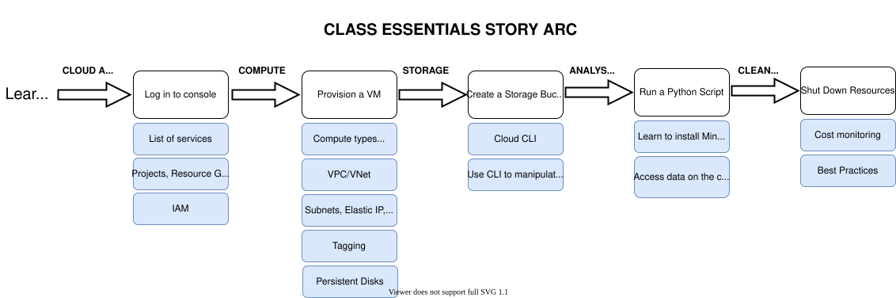

<!-- #region -->
# Internet2 CLASS Essentials

The Internet2 CLASS Essentials program will introduce you to compute and storage on three major cloud providers: Amazon Web Services (AWS), Microsoft Azure and Google Cloud Platform (GCP). The following image outlines the story arc and components that you will learn through a series of hands-on, interactive tutorials:



In CLASS Essentials, you will learn how to:
1. Log in and navigate the cloud console
2. Create a cloud computing instance and understand the the components of cloud compute
3. Create a cloud storage bucket
4. Run a simple analysis on the compute instance you built and utilize the data in the storage bucket
5. Monitor costs 
6. Clean up your resources and utilize best practices for developing research workflows on the cloud


## Prerequisites

**Cloud Account** 

If you are taking the CLASS Essentials Workshop offered by Internet2, cloud accounts will be provisioned for you as part of that class. Information on your account and further set up will be sent to you after registration. 

For self-paced learning, you will need an institutional account, an agency-funded account (e.g. via Cloudbank), or a personal cloud account. Please note that we are unable to support or troubleshoot problems or errors that occur for self-paced learning. 


## CLASS Cloud Adoption Framework

```{attention} 
Cloud computing is a utility. Since you pay for the resources you use, it can be very cost-effective, but can also be very costly if you don’t manage it carefully!

```

The CLASS Cloud Adoption Framework is a collection of documentation, best practices, tutorials, workflows, and cloud adoption pathways built by researchers and research and data (RCD) professionals ***for*** researchers and RCD professionals. In "adopting" the cloud, the onus is on users to manage costs, to understand the myriad cloud computing jargon, and to rethink how to adapt traditional workflows to a more "cloud-native" solution. 

## Issues
Contact [the CLASS team](mailto:class@internet2.edu?subject=Question%20about%20CLASS-Essentials-AWS) if you have questions, suggestions or comments. 

## Acknowledgements

Content for this site was authored by John Hicks, Tim Middelkoop, Ananya Ravipati and Amanda Tan at Internet2 in collaboration with the CLASS and research community. [Find out more here](https://internet2.edu/community/research-engagement/internet2-research-engagement-team/)!

## License
The Cloud Learning and Skills Sessions materials (“Materials”) were created by University Corporation for Advanced Internet Development dba Internet2 (“Internet2”) and are shared under the Creative Commons Attribution-NonCommercial-ShareAlike 4.0 International license (“License”), avail. at https://creativecommons.org/licenses/by-nc-sa/4.0/legalcode. This License permits you to share and modify the Materials, subject to important terms and conditions, which include, without limitation, that (1) you may only use the Materials for non-commercial purposes; (2) if you share the Materials, you must comply with the License’s attribution requirements; and (3), if you modify the Materials, you must distribute your contributions under the same license terms. You agree to review the full License text before accessing the Materials.


<!-- #endregion -->
